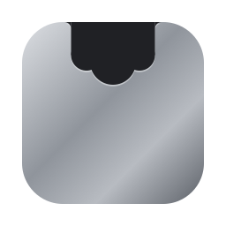

<h1 align="center">Kumo</h1>

A quiet dashboard in your Mac’s notch. Free · Native · No account

<a href="https://kumonotch.com">kumonotch.com</a> · <a href="#中文">中文</a>

---

Kumo turns the notch on your Mac into a small dashboard you can glance at: what’s playing, what’s next on your calendar, what you just copied, and how your Mac is holding up. Hover to open. Move away and it’s gone.

**This repository holds the signed, notarized builds and their release notes.** Kumo is free to download; the source code is private.

## Download

The first public release is coming soon. Click **Watch → Custom → Releases** at the top of this page to be told when it’s out.

Once it’s out, the latest version is always at [Releases](https://github.com/billyxu008/kumonotch-releases/releases/latest).

**Requirements:** macOS 15 or later, Apple silicon or Intel. On a MacBook it lines up with the camera notch; on a screen without one it draws a notch at the top centre (you can turn that off).

## What it does

- **Now playing.** Apple Music, Spotify, or a video in your browser: artwork, a scrubbable progress bar and controls when open, a small visualizer when closed.
- **Calendar and Reminders.** Today and tomorrow at a glance. A Join button for Zoom, Google Meet, Teams, Feishu, Tencent Meeting and Webex links. The notch drops down five minutes before a meeting. Tick off reminders or add one.
- **A shelf for what you copy.** Text, links, images and files land on a shelf. Click to copy again, drag out into any app, pin what you want to keep. Items a password manager marks as secret are never recorded.
- **Screenshots and recording.** ⌃⌥S grabs an area and puts it on the shelf. ⌃⌥R starts and stops a screen recording, with a timer in the notch.
- **System.** CPU, GPU, memory, disk, network, chip temperature, fans and battery, and how much the app in front of you is using. When the fans spin up, the notch tells you which app is responsible.
- **English and 中文.**

## Permissions

| Permission | Why | Needed for |
|---|---|---|
| Calendars | Show your events and meeting links | Agenda |
| Reminders | Show and complete reminders | Agenda |
| Screen Recording | Take screenshots and recordings | ⌃⌥S and ⌃⌥R only |

Everything else works without them.

## Privacy

Kumo has no account, no server and no analytics. The app itself makes no network requests: your clipboard history, calendar and system stats stay on your Mac. Links you click (a meeting’s Join button, for example) open in your browser.

## Only download Kumo from here

The official places are **kumonotch.com** and **this repository**. Builds anywhere else are not from me.

## Feedback

Bugs and ideas: [open an issue](https://github.com/billyxu008/kumonotch-releases/issues). If something feels off, I want to hear it.

---

<h2 id="中文">中文</h2>

Kumo 把 Mac 的刘海变成一块抬眼就能看的小面板：正在播放什么、下一个日程是什么、刚刚复制了什么、电脑现在累不累。鼠标移上去就展开，移开就收起。

**这个仓库只放签名、公证过的安装包和更新说明。** Kumo 免费下载，源码不公开。

- **下载**：首个公开版本即将推出。点页面上方的 **Watch → Custom → Releases**，发布时会通知你。之后最新版永远在 [Releases](https://github.com/billyxu008/kumonotch-releases/releases/latest)。
- **系统要求**：macOS 15 及以上，Apple 芯片和 Intel 都支持。没有刘海的屏幕会在顶部正中画一个（可以关掉）。
- **权限**：日历和提醒事项用来显示日程；录屏权限只在用截图或录屏时才需要。其他功能都不需要授权。
- **隐私**：没有账号、没有服务器、没有数据统计。App 本身不联网，剪贴板历史、日程和系统数据都只留在你的 Mac 上。
- **只从这里下载**：官方渠道只有 **kumonotch.com** 和**这个仓库**。
- **反馈**：[提一个 issue](https://github.com/billyxu008/kumonotch-releases/issues)。哪里用着不顺手，我很想知道。

---

Made by <a href="https://billyxu.dev/?utm_source=github&utm_medium=referral&utm_campaign=kumo&utm_content=releases-readme">Billy Xu</a> · © 2026 Billy Xu. Free to use; not open source.

